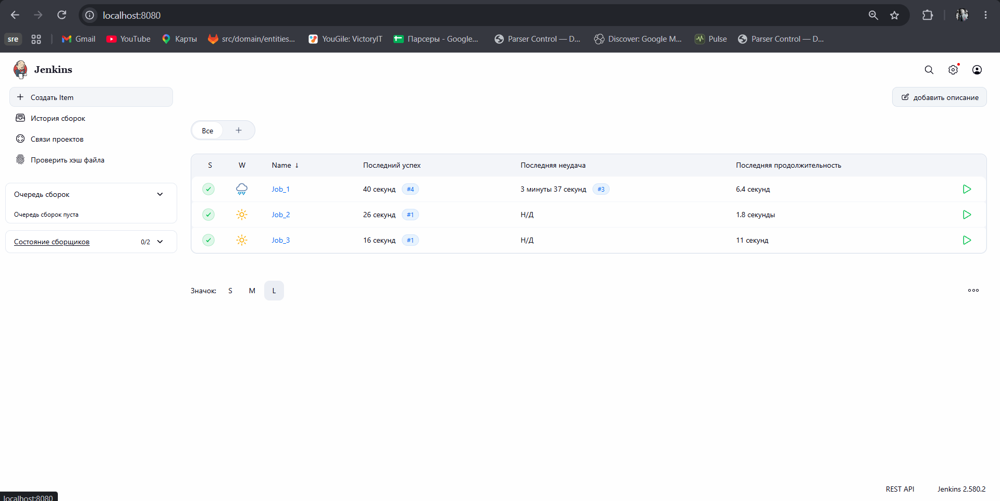
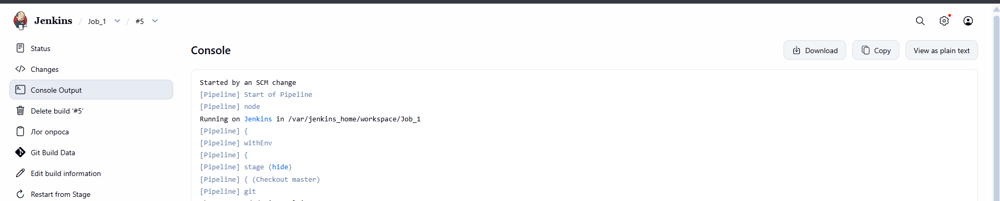
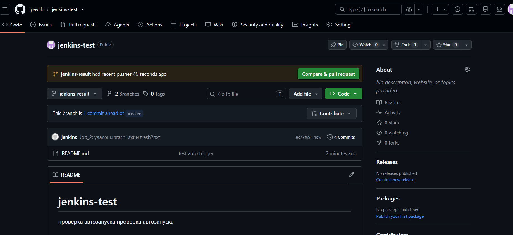

# Задание 8. Jenkins

Git - публичный репозиторий на GitHub: https://github.com/pavilk/jenkins-test

Jenkins запущен в докере, см. docker-compose.yml. Интерфейс на localhost:8080.

```
docker compose up -d
docker compose exec jenkins cat /var/jenkins_home/secrets/initialAdminPassword
```

Из плагинов нужны Pipeline и Git. Для пуша в GitHub добавил credentials (логин + токен) с id `github`.

Джобы лежат в папке jobs, это pipeline-скрипты:

- Job_1 - забирает ветку master и копирует проект в $JENKINS_HOME/storage/project. Раз в 2 минуты проверяет master (pollSCM), если есть новый коммит - запускается сам. В конце запускает Job_2.
- Job_2 - удаляет из проекта trash1.txt и trash2.txt, потом запускает Job_3.
- Job_3 - коммитит и пушит проект обратно в GitHub.

Job_3 пушит в отдельную ветку jenkins-result, а не в master. Если пушить в master, Job_1 увидит новый коммит и всё запустится заново по кругу.

Job_1 надо один раз запустить руками, после этого Jenkins начинает опрашивать репозиторий.

## Скриншоты

Все три джобы отработали:



Сделал коммит в master, Job_1 запустился сам (Started by an SCM change):

```
echo "проверка автозапуска" >> README.md && git commit -am "test auto trigger" && git push
```



Ветка jenkins-result, файлов trash1.txt и trash2.txt нет:


