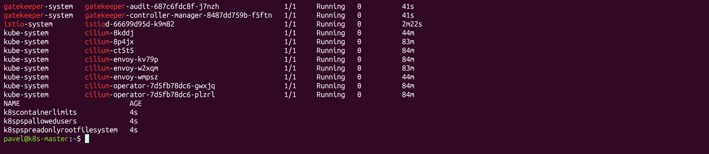
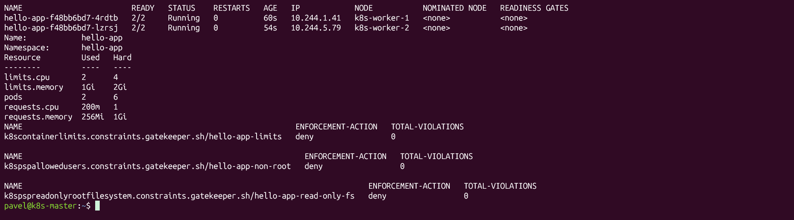
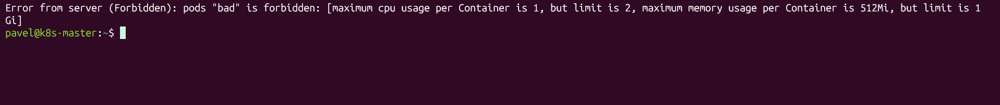
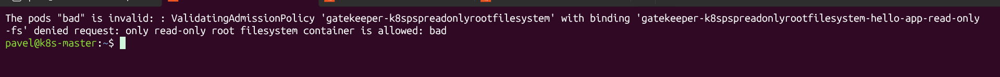
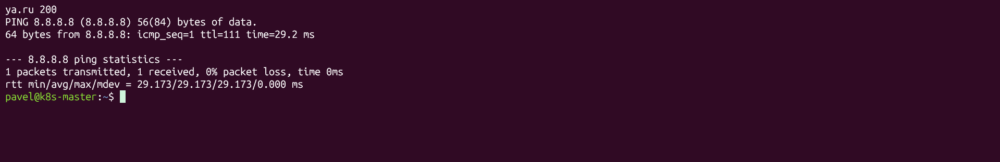
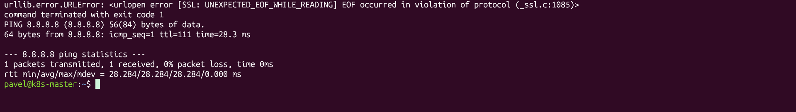
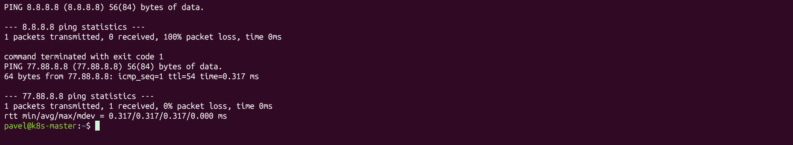

# Задание 10

Делал на том же кластере, что и в задании 9 (3 ноды, cilium, traefik, приложение hello-app).

## Установка

Cilium уже стоял как сеть кластера. Istio и OPA Gatekeeper ставятся скриптом install.sh:

- istio в профиле minimal, то есть только istiod (свой ingress gateway не нужен, вход через traefik)
- gatekeeper через helm
- шаблоны политик из gatekeeper-library: allowed users, read-only root filesystem, container limits

```
bash install.sh
kubectl get pods -A | grep -E 'istio|gatekeeper|cilium'
kubectl get constrainttemplates
```



## Ограничения для namespace и подов

В policies/namespace-limits.yaml:

- ResourceQuota - сколько всего CPU, памяти и подов можно в namespace
- LimitRange - лимиты по умолчанию и максимум на один контейнер

В app.yaml то же приложение, что в задании 9, но с ограничениями:

- requests и limits по CPU и памяти
- readOnlyRootFilesystem: true
- runAsNonRoot, runAsUser: 999, allowPrivilegeEscalation: false

На namespace стоит метка istio-injection=enabled, поэтому в каждом поде есть sidecar istio. Ему тоже задал ресурсы аннотациями, иначе по умолчанию он просит слишком много и не влезает в квоту.

В policies/gatekeeper-constraints.yaml три политики gatekeeper на namespace hello-app. Они не дают создать под, который запускается от root, может писать в файловую систему или без лимитов.

```
kubectl apply -f policies/namespace-limits.yaml -f policies/gatekeeper-constraints.yaml
kubectl apply -f app.yaml
kubectl -n hello-app rollout restart deploy/hello-app
kubectl -n hello-app get pods -o wide
kubectl -n hello-app describe quota
kubectl get constraints
```



Проверка - пробую создать под от root:

```
kubectl -n hello-app run bad --image=busybox -- sleep 3600
```

Сначала его не пустил LimitRange: istio добавил в под sidecar со своими лимитами по умолчанию, а они больше максимума.



Без sidecar под уже дошёл до gatekeeper, и тот его не пустил:

```
kubectl -n hello-app run bad --image=busybox --labels=sidecar.istio.io/inject=false -- sleep 3600
```



## Ограничение доступа наружу

Две политики:

- policies/istio-egress.yaml - для namespace включен outboundTrafficPolicy REGISTRY_ONLY. Sidecar пропускает наружу только к сервисам, которые знает istio, остальное режет. Но istio видит только TCP, ping через него не идёт.
- policies/cilium-egress.yaml - CiliumNetworkPolicy. Подам приложения разрешены только DNS кластера, istiod и ping до 77.88.8.8 (он нужен для /health). Остальное запрещено, в том числе ping куда-то ещё.

Проверял из пода приложения:

```
kubectl -n hello-app exec deploy/hello-app -c hello-app -- python -c "import urllib.request as u; print('ya.ru', u.urlopen('https://ya.ru', timeout=5).status)"
kubectl -n hello-app exec deploy/hello-app -c hello-app -- ping -c1 -W2 8.8.8.8
kubectl -n hello-app exec deploy/hello-app -c hello-app -- ping -c1 -W2 77.88.8.8
```

До политик доступно всё:



После политики istio ya.ru не открывается, а ping 8.8.8.8 ещё проходит:



После политики cilium ping 8.8.8.8 не проходит, а 77.88.8.8 работает:


