# Задание 9

Всё делал в Yandex Cloud. Файлы по папкам:

- 03-app - приложение, Dockerfile, systemd, docker compose с prometheus и alertmanager
- 04-nat - настройка NAT
- 05-k8s - kubernetes

Скриншоты лежат в report/screenshots в каждой папке.

## Приложение

FastAPI, код в 03-app/app/main.py.

- POST / с заголовком `Test: Hello` возвращает "Hello, World!", на всё остальное 403
- /health пингует 77.88.8.8, если пинг прошёл - 200 и "OK", иначе 503
- /metrics - метрики для prometheus

## systemd

ВМ на Ubuntu 22.04. Сервис запускается от отдельного системного пользователя hello-app (без шелла и домашней папки):

```
hello-app:x:999:999::/home/hello-app:/usr/sbin/nologin
```

Юнит - 03-app/deploy/systemd/hello-app.service. Установка скриптом install.sh: создаёт пользователя, ставит приложение в /opt/hello-app в venv, кладёт юнит и включает его.

```
sudo bash deploy/systemd/install.sh
systemctl status hello-app
ps -o user:12,pid,cmd -C uvicorn
curl -X POST -H "Test: Hello" localhost:8000/; echo
curl -s -o /dev/null -w "%{http_code}\n" localhost:8000/
```

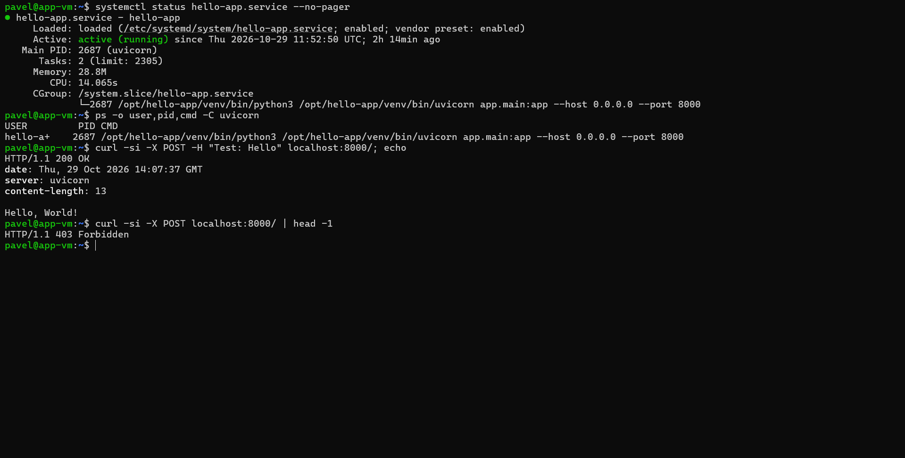

## Docker

03-app/Dockerfile. Внутри контейнера приложение работает не от root, а от пользователя app. Есть healthcheck на /health.

```
docker build -t hello-app:1.0 .
docker images hello-app
docker run --rm hello-app:1.0 id
```

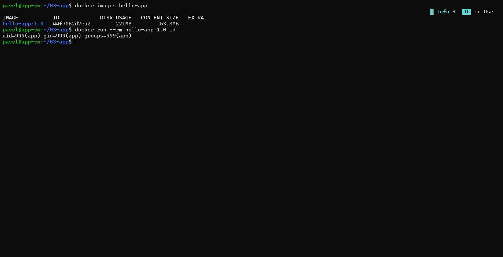

## docker compose и мониторинг

В docker-compose.yml три сервиса: app, prometheus, alertmanager. Конфиги в 03-app/monitoring.

Prometheus собирает /metrics приложения. Алерты (alerts.yml):

- HelloAppDown - приложение не отвечает больше 30 секунд
- HelloAppHealthFailing - /health отдаёт 5xx
- HelloAppHighErrorRate - больше 10% ответов с 5xx

В alertmanager настроено, что если приложение лежит (HelloAppDown), остальные два алерта не присылаются. Куда слать уведомления не настраивал, алерты видно в веб-интерфейсе alertmanager.

Порты prometheus и alertmanager открыты только на 127.0.0.1, смотрел их через ssh туннель:

```
docker compose up -d --build
ssh -L 9090:localhost:9090 -L 9093:localhost:9093 pavel@<ip vm>
```

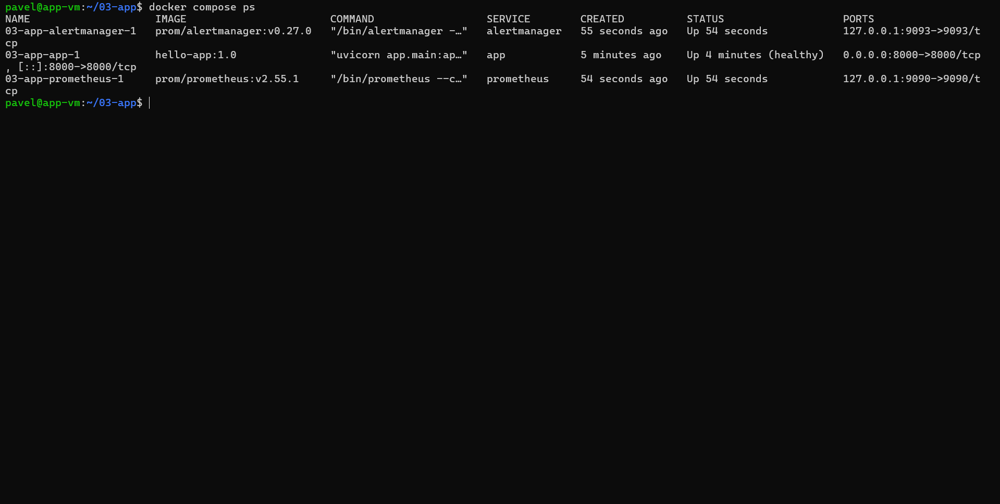

Prometheus видит приложение:

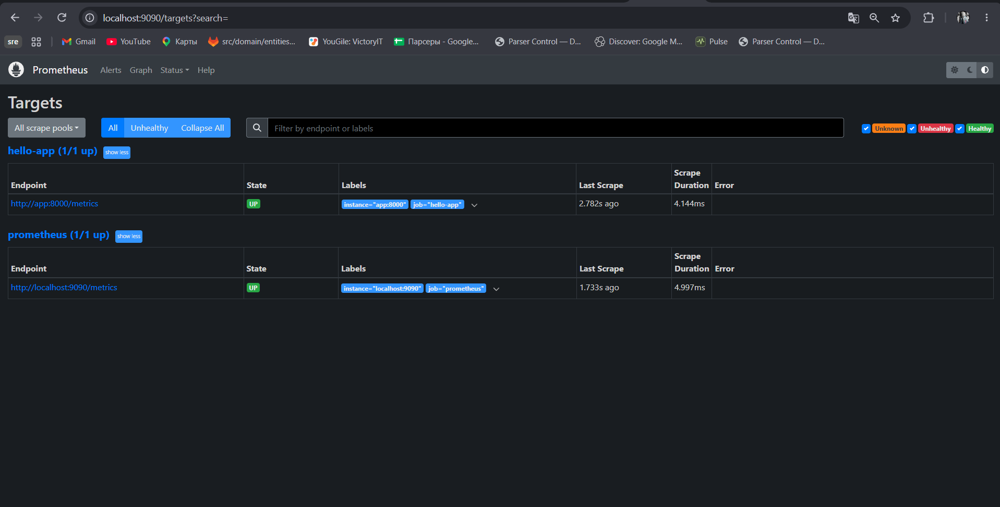

Запросы по эндпоинтам и кодам ответа:

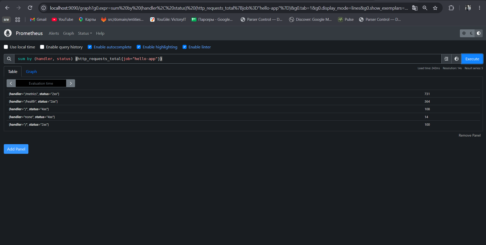

Проверка алерта - остановил приложение и потом запустил обратно:

```
docker compose stop app
docker compose start app
```

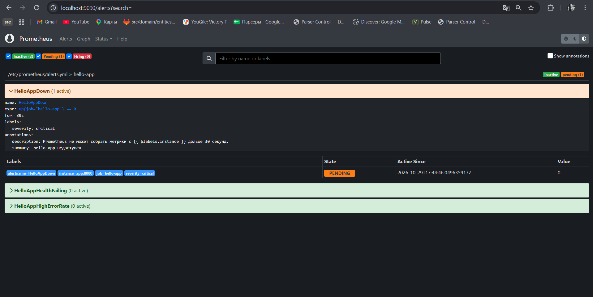

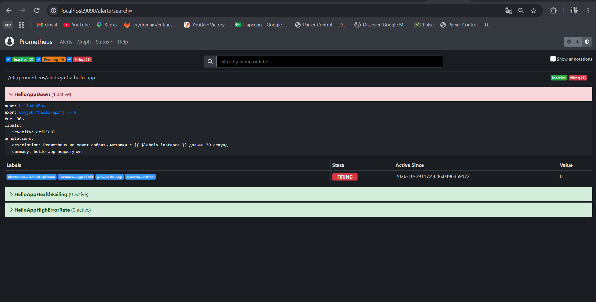

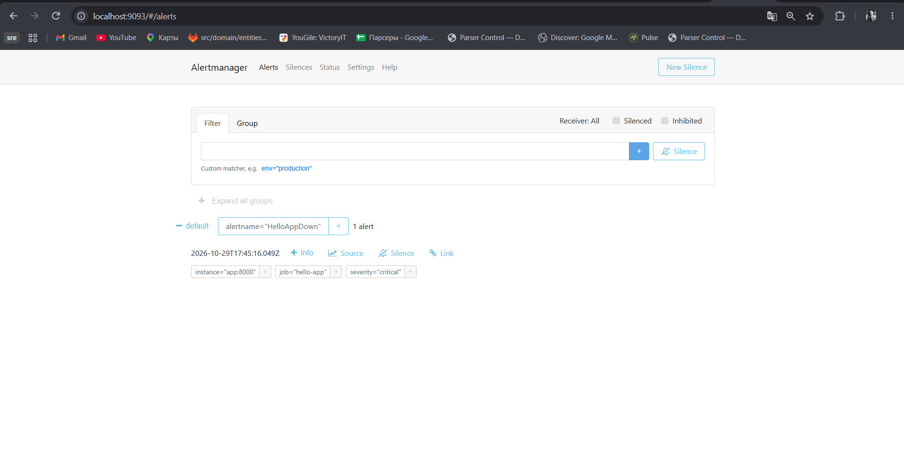

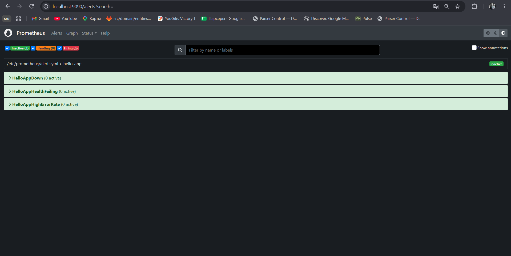

## NAT

Сделал две подсети: public (10.0.1.0/24) и private (10.0.2.0/24). NAT-машина с двумя интерфейсами: eth0 в public с публичным IP, eth1 в private с адресом 10.0.2.10.

На NAT запускается 04-nat/setup-nat.sh:

- netplan - eth0 по dhcp, eth1 статикой
- включает ip_forward
- MASQUERADE для 10.0.2.0/24
- проброс порта 8000 на 10.0.2.20, чтобы приложение было видно снаружи
- сохраняет правила iptables

```
sudo bash setup-nat.sh
ip -br addr; sysctl net.ipv4.ip_forward; sudo iptables -t nat -S
```

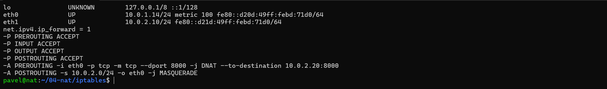

В яндексе маршрут через NAT задаётся таблицей маршрутизации на подсети private (0.0.0.0/0 -> 10.0.2.10), на самой ВМ ничего не прописывается.

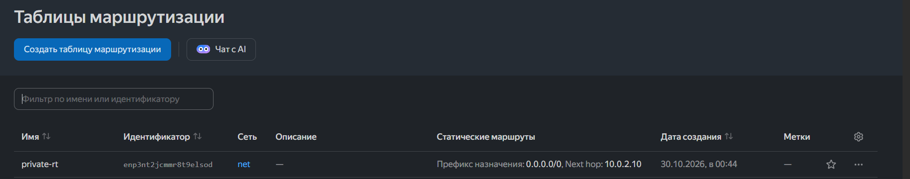

ВМ с приложением перенёс в подсеть private (адрес 10.0.2.20) и убрал у неё публичный IP. Зайти на неё теперь можно только через NAT:

```
ssh -J pavel@153.51.115.69 pavel@10.0.2.20
ip -br addr; ip route; curl -4 -s -m5 api.ipify.org; echo
```

В интернет она выходит с адресом NAT:

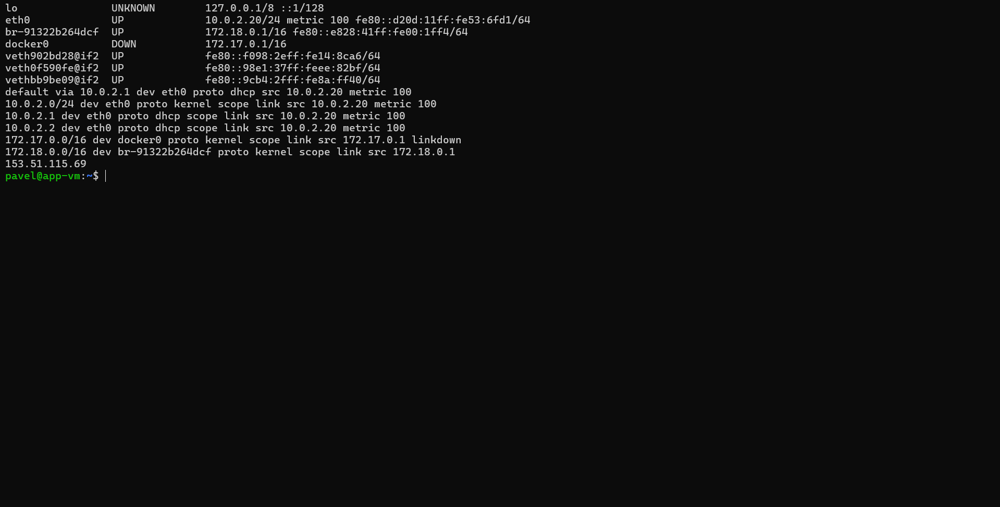

В консоли облака у ВМ нет публичного адреса, она в подсети private:

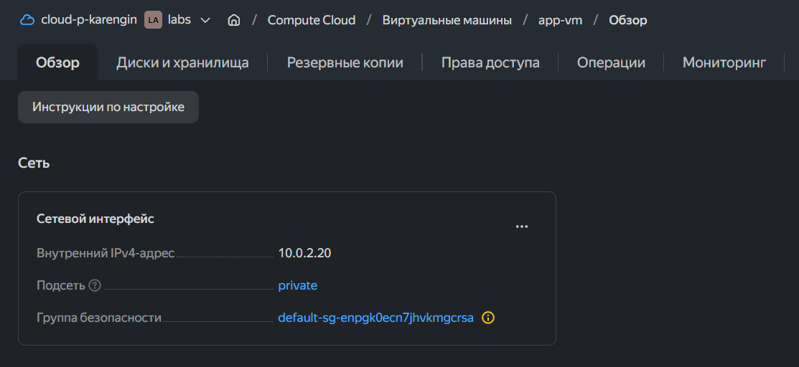

Приложение снаружи через NAT. /health отвечает OK, значит пинг с ВМ тоже идёт через NAT:

```
curl -X POST -H "Test: Hello" http://153.51.115.69:8000/; echo
curl http://153.51.115.69:8000/health; echo
```

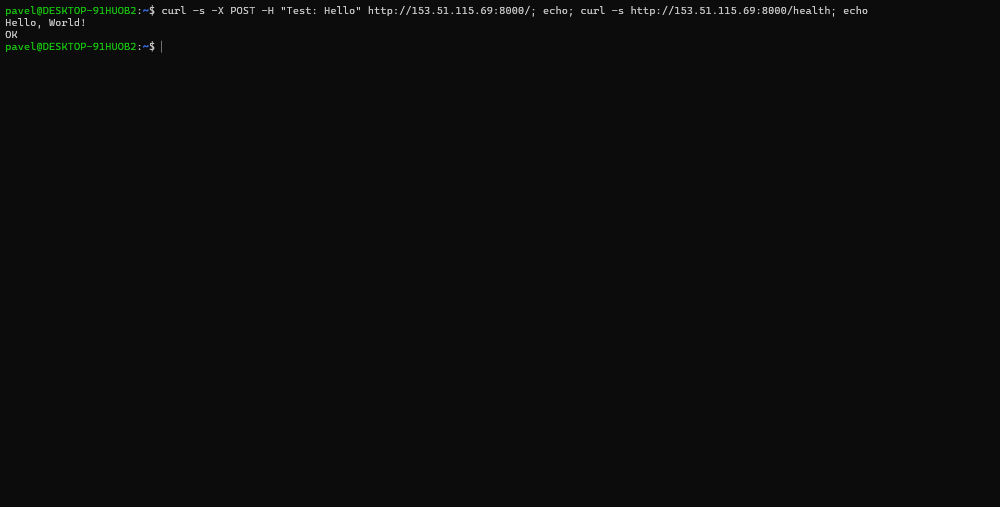

## Kubernetes

Три ВМ: k8s-master, k8s-worker-1, k8s-worker-2. Ставил через kubeadm, containerd, сеть - cilium, ingress - traefik.

На всех нодах 05-k8s/node-prep.sh (containerd, kubelet, kubeadm, kubectl), на мастере master-init.sh (kubeadm init, helm, cilium). Воркеры подключал через kubeadm join.

```
kubectl get nodes -o wide
kubectl -n kube-system get pods
```

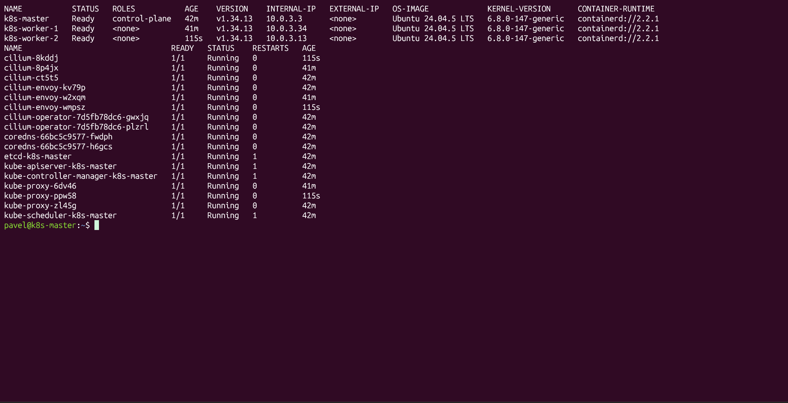

### Приложение

Манифест 05-k8s/manifests/app.yaml - deployment на 2 реплики и service.

Registry не поднимал, образ загружен в containerd на воркерах:

```
docker save hello-app:1.0 > img.tar
sudo ctr -n k8s.io images import img.tar
```

```
kubectl apply -f manifests/app.yaml
kubectl -n hello-app get deploy,pods,svc -o wide
```

Проверка изнутри кластера:

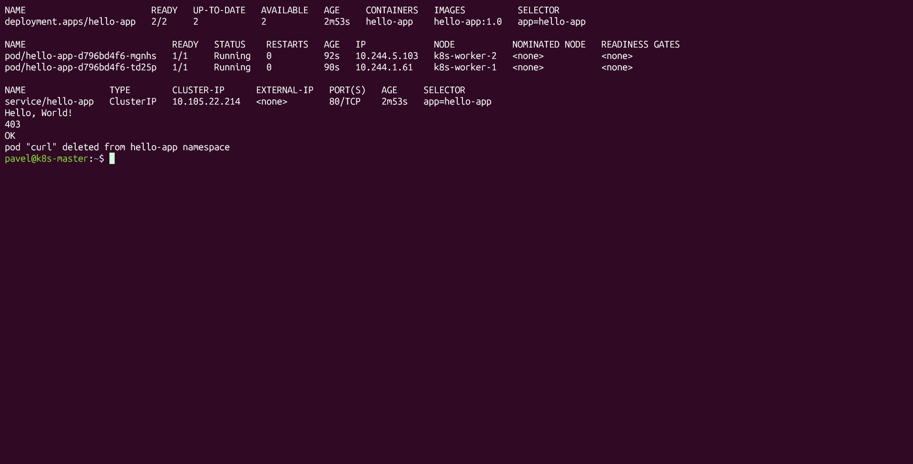

### Ingress

Traefik ставил через helm, настройки в traefik-values.yaml. Он работает на каждом воркере и слушает 80 порт прямо на ноде (hostNetwork), поэтому port-forward не нужен.

```
helm repo add traefik https://traefik.github.io/charts
helm install traefik traefik/traefik -n traefik --create-namespace -f traefik-values.yaml
kubectl apply -f manifests/ingress.yaml
```

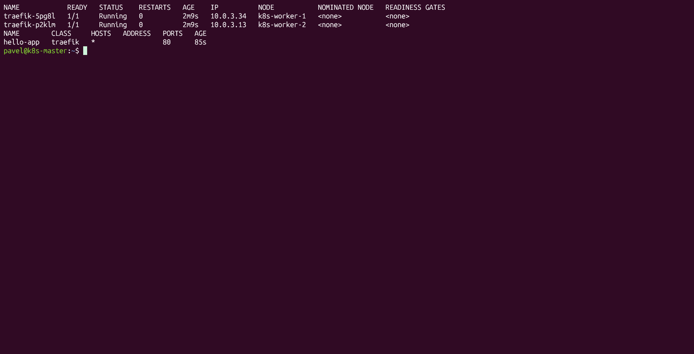

Проверка снаружи через оба воркера:

```
for ip in 84.201.171.109 84.252.132.51; do
  curl -s -X POST -H "Test: Hello" http://$ip/; echo
  curl -s -o /dev/null -w "%{http_code}\n" http://$ip/
  curl -s http://$ip/health; echo
done
```

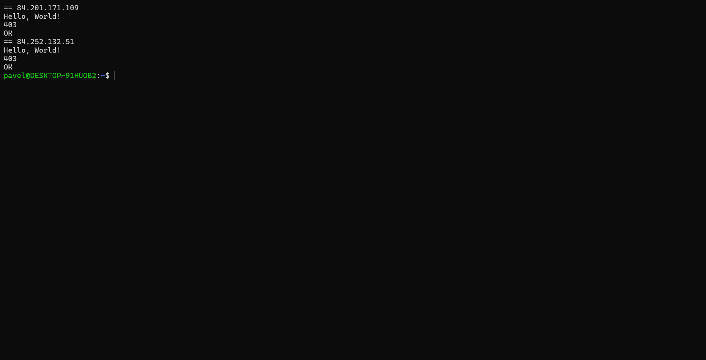
